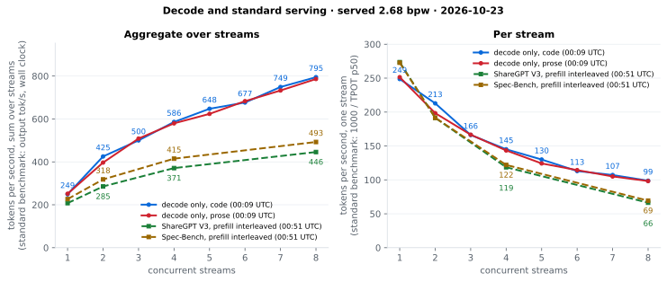
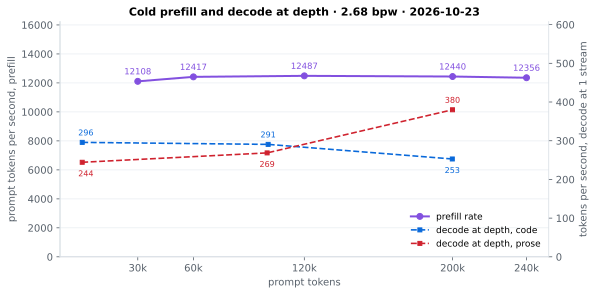

# Qwen3.8-Flash-Next on 2× RTX 5090 (ExLlamaV3 + TabbyAPI)

Serving configuration, launcher, image recipe, kernel overlays, instruments and measurements for [Qwen3.8-Flash-Next][qwen-hf] on two RTX 5090 cards, served as `qwen3.8-flash-next-exl3-2.68bpw-selfcal`.

The serving configuration supports concurrent coding-agent sessions with growing contexts. The launcher sets eight slots and a shared KV page pool; the measurements below cover decode, cold prefill, standard serving traffic and quality checks on that configuration.

- **Checkpoint**: [turboderp's self-calibrated 2.68 bpw EXL3 quant][ckpt-268], revision `2.68bpw_h6_ng8`, 6-bit output head, 8-bit n-gram table and 2.5-bit MTP.
- **Engine and server**: [ExLlamaV3][exl3] `dev` `5783a93` (v1.5.2) plus this repository's overlays, under [TabbyAPI][tabby] `53da7919`; image `tabbyapi:tune268-r2`, 50 launcher selectors ([`docker/`][docker-readme]).
- **Capacity**: 262,144-token request window, 819,200-token shared page pool, 8-bit KV, eight slots and layer split `[30, 30]`.
- **Drafting**: the checkpoint's MTP head, depth three through four jobs and depth two at five to eight; prompt lookup enabled at actual batch one after probation.
- **Interface**: vision, separate reasoning and `qwen3_coder` tool parsing configured by [`scripts/launch-flashnext.sh`][launcher].

Measurements are dated 2026-10-23 and linked to their published records in [the served 2.68 write-up][p268]. The experiment index is [`bench/RESULTS.md`][results].

## Numbers

Measured 2026-10-23 on `tabbyapi:tune268-r2`, the 2.68 bpw self-calibrated checkpoint, pool 819,200 and all 50 served selectors: [run `20261023T000904Z`][p268-a] supplies decode, prefill and depth; [run `20261023T005148Z`][p268-d] supplies standard serving. `fn_bench` records greedy code/prose bursts of 1,024 forced tokens at one to eight streams; `vllm bench serve` records closed-loop ShareGPT and Spec-Bench traffic. Decode rate excludes time to the first token; decode aggregate is the mean round sum of concurrent request rates, and standard aggregate is output tokens over wall time ([method][p268]).



Solid lines show decode alone on code and prose; dashed lines show ShareGPT and Spec-Bench with new requests' prefill interleaved. The [decode-only figure](docs/img/decode-scaling.svg) uses the same decode records.

- At one stream, code / prose decode is 248.7 / 251.4 t/s. At eight streams, code / prose decode aggregate is 795 / 786 t/s, with median per-stream rates 98.8 / 98.2 t/s; each request forces 1,024 greedy tokens on a 118 / 106-token prompt ([`20261023T000904Z`][p268-a]).
- At eight streams, ShareGPT / Spec-Bench output is 445.9 / 492.7 tok/s over wall time, with per-stream 1000 / TPOT p50 of 66 / 69 t/s; output lengths follow the ShareGPT references or force 256 tokens for Spec-Bench ([`20261023T005148Z`][p268-d]).
- Decode-burst TTFT medians are 0.163 / 0.155 s at one stream and 0.919 / 0.910 s at eight (code / prose, greedy, 1,024 forced tokens; [`20261023T000904Z`][p268-a]).



Cold prefill averages 12,440 prompt tokens/s at 199,977 prompt tokens (16.076 s TTFT), and 12,356 prompt tokens/s at 239,866 (19.413 s); each point is the mean of three salted prompts with 64 forced greedy output tokens ([`20261023T000904Z`, unit b][p268-b]). Decode at depth averages each cold/cached pair at one stream with 2,048 forced greedy tokens ([unit c][p268-c]).

| | value | source |
| --- | --- | --- |
| context window | 262,144 tokens | [served launcher][launcher]; [configuration][config] |
| shared page pool | 819,200 tokens, eight slots, 8-bit KV | [served launcher][launcher]; [`20261023T000904Z` boot projections][p268-a] |
| free VRAM after boot warm-up, GPUs 0 / 1 | both decode boots: launcher 1,213 / 815 MiB; later NVML 1,212 / 814 MiB | [`20261023T000904Z`, `boots.tsv`][p268-a] |
| long-context substring retrieval | 5/5 at 105,680 and 5/5 at 193,464 actual prompt tokens; five positions per length, all `length` finishes, hits in combined reasoning/visible text | [`20261023T031345Z`, needle outcomes and summary][p268-e] |
| GSM8K five-shot, n=500, no stop strings, c8, T=0, max 8,192 | flexible extraction 0.982; strict 0.976 | [`20261023T031345Z`, GSM outcomes and summary][p268-e] |
| [tool-eval-bench][tool-eval] 2.1.0, 69 × 4, parallel 8, T=.6/top_p=.95/top_k=20 | final trial 88; trials 88/87/89/88; CLI mean 88, sample SD 0.8 | [`20261023T031345Z`, tool outcomes and summary][p268-e] |
| boot to serving, existing tune cache | 18.269 / 18.319 s, launcher invocation through ready/warm-up and model check | [`20261023T000904Z`, both decode boots][p268-a] |

### Conditions

The decode curve has two boots, one unrecorded warm-up and three measured rounds per shape, 432 requests, distinct stream suffixes and 118 / 106-token code / prose prompts. Prefill has three salted prompts per target through 240k; depth has two requests per shape at one stream. The standard matrix has two replication passes, a fresh boot per cell and 7,040 measured requests at one, two, four and eight concurrent requests. All units use the served boot warm-up, NVMe off, stock 600 / 575 W power limits, core offset zero and memory offset +4500 MHz, with independent per-boot copies of the existing tune cache ([method and boot readbacks][p268]).

## Served configuration

- Image `tabbyapi:tune268-r2`, pinned to `sha256:2239954c372397b97ec3d570d887fe0afe679e8de214dfda558f5095d8f855fd`; 50 launcher selectors. The [launcher][launcher], [`docs/CONFIG.md`][config] and [image chain][docker-readme] specify the configuration; [history][history] records the promotion.
- Checkpoint `qwen3.8-flash-next-exl3-2.68bpw-selfcal`, [turboderp revision `2.68bpw_h6_ng8`][ckpt-268]: experts K3 on layers 0–3/44–47, K2.5 on 4–43, dense/shared K6, 6-bit output head, 8-bit n-gram table and 2.5-bit MTP.
- 262,144-token window, 819,200-token shared pool, eight slots, 8-bit KV, layer split `[30, 30]`, draft component on GPU 1 and draft policy `[[4, 3], [8, 2]]`.
- The launcher enables `EXL3_DENSE_V2_K6=1`, `EXL3_MOE_COOP_HALF=1` and `EXL3_MOE_PREFILL_E3_HALF=1`; the round-2 histogram, static and uncapped alternatives remain at their image default 0. All six selectors default off in their overlay recipes.
- Prefill merge, asynchronous recurrent stashes, tail checkpoints, resumable whole-prompt prefill, adaptive prompt lookup and cache trace are enabled; NVMe tier is off. Kernel caches use `/srv/qwen5090/.exl3cache-tune268`; the launcher performs the served boot warm-up.

## What the stack is

The [checkpoint][ckpt-268] is turboderp's self-calibrated EXL3 quantization of Qwen3.8-Flash-Next. [ExLlamaV3][exl3] `dev` `5783a93` and [TabbyAPI][tabby] `53da7919` supply the inference engine and OpenAI-compatible server. The complete source overlay chain is in [`docker/`][docker-readme], with attribution and licences in [`THIRD_PARTY.md`][third-party].

The engine overlays cover multi-job QSA, concurrency-indexed MTP drafting, cooperative MoE decode, dense projections, the hyper-connection mixer, two-card prefill, recurrent checkpoints and prompt lookup. The 2.68 overlays add K6 dense V2 twins, K2.5 cooperative decode and K2.5 grouped E3 prefill. The build verifies patch hashes and predecessor SASS; the launcher enables the measured selectors ([recipe][docker-readme]).

TabbyAPI carries the reasoning-loop handling, one prompt encode per request and off-loop encoding above 12,000 characters. Sampler fallbacks are temperature 1.0, top_k 20 and top_p 0.95 with `force: false`; client settings take precedence. Vision, reasoning and tool parsing are enabled in the generated configuration ([settings][config]).

## Hardware

Read from the box on 2026-09-19. Every number in this README was measured on this hardware and driver; the memory clock offset is stated per period below.

- Host: ASRock X870 Taichi Creator, AMD Ryzen 7 9800X3D, 64 GB DDR5-6000 (2 × 32 GB), Ubuntu 24.04.4 LTS, kernel 7.0.0-30-generic.
- GPUs: two RTX 5090 32 GB (`sm_120`) on PCIe Gen5 x8/x8. Power limits are the cards' defaults, 600 W (ASUS, `cuda:0`) and 575 W (HP OEM, `cuda:1`). Memory clock offset +4500 MHz on both cards, core clock stock. A boot-time service applies them once per host boot, and since 2026-09-25 the launcher sets the memory offset before every engine boot and logs the readback. The offset had reset to 0 between 2026-09-03 and 2026-09-19 without a reboot, so the numbers measured from 2026-09-19 to 2026-09-25 02:22 UTC ran at the stock memory clock; +4500 is +14.3 % DRAM bandwidth and +1.7 to +1.8 % decode per stream at 1 stream ([R726][r726]).
- Driver: NVIDIA 610.57.04 open kernel modules, CUDA 13.3 user-mode driver.
- Storage: one KIOXIA KBG80ZNV2T04 2 TB NVMe (ext4) holds the checkpoint, including the n-gram table that decode reads rows from; the NVMe prefix tier is disabled by default. A sequential 16 MiB `O_DIRECT` read of a tier segment ran at 6.7 GB/s (2026-09-19).

## Measured and not served

Each entry names the change and the number that kept it out of the served configuration. c1, c4 and c6 mean 1, 4 and 6 concurrent streams.

- A windowed MTP draft cache, a sink page plus the last 16,384 tokens per slot (in the image, off): +3.4 % page pool ([R579][r579]), but a prompt revived from the prompt cache in a later request group drafts 0.655 accepted per proposed token against 0.868 without it, and an agent-shaped replay decodes 2.0 % faster per stream without it ([R728][r728]).
- Mixed draft depth per job inside one verify batch, so 5 to 7 streams fill the 16 verify rows: 0.79× at 5 streams and 0.84× at 7, code, 256 forced tokens, greedy. The verify window grows to the deepest job in the batch, which adds a sequential draft level to every step ([R678b][r678b]).
- 17 to 32 verify rows on the cooperative MoE kernels, as two calls of at most 16 rows: bit-identical, −14.5 % at 8 streams against drafting one token ([R566][r566]). One launch of up to 32 rows is served since 2026-09-25 ([R717][r717]).
- Draft depth 2 above 4 jobs on the 16-row decode paths: −32 to −39 % at 6 and 8 streams, because 18 and 24 verify rows fell off the cooperative MoE decode kernels (2026-09-19, [R560][r560], [R562][r562]). With the rows32 paths depth 2 at 6 to 8 jobs is served since 2026-09-25 ([R717][r717]).
- Draft depth 4 at 1 stream, with or without a controller: costs 32,768 page-pool tokens and returns at most about +2 % ([R567][r567]).
- A deeper MTP draft for a single decoding job (depth 4 or 5 instead of 3), all arms at a 753,664-token pool: +4.8 / +5.2 % code and −5.4 / −8.2 % prose at 1 stream against depth 3, 16,384 / 49,152 fewer pool tokens than the served 819,200 of that date, and a different greedy output (2026-09-19, [R537][r537]).
- Adaptive MTP draft depth, round 2: −2.4 to −3.5 % prose at 1 stream, no gain on code ([R556][r556]).
- Two draft chains verified together: +5 to +6.5 % accepted tokens for twice the verify rows, modelled at −10 to −13 % ([R564][r564]).
- A 4,096-token prefill chunk: does not boot beside the page pool ([R574][r574]).
- Prefill chunk 1,024 or 512 instead of 2,048: running streams get 1.5× the decode frames while another request prefills, but cold prefill runs at about half the rate and the new request waits 1.4–1.7× longer for its first token ([R553][r553]). Chunk 1,024 for pool size: [R483][r483], [R485][r485].
- The served stack on upstream `dev` `1d64111`: −49,152 pool tokens and 1–3 % decode ([R563][r563]). A later port onto `dev` `5783a93` is served since 2026-09-27, at −81,920 pool tokens ([R784][r784]).
- The MTP draft's embedding copy on cuda:0: +16,384 pool tokens for −1.8 % code and −2.0 % prose at 1 stream ([R555][r555]).
- The K=3 MoE decode kernel without register spills: bit-exact, slower per call in 28 of 30 kernel cells, −0.37 % code at c1 over 8 boots with a 95 % interval of −0.83 to +0.09 % (2026-09-19, [R536][r536]).
- Recurrent checkpoints stored at the end of each reply: correct, but they save about 9k prefill tokens over a 120-call agent replay, below its run-to-run spread ([R524][r524]).
- A fused shared-expert kernel: after the side-stream overlap the shared expert's residual is 1.9 µs per layer at 4 rows, at most 0.6 % of a 1-stream step and 1.2 % at 4 streams ([R521][r521]).
- `EXL3_INT8_GEMV=0`: −0.3 % at c1 with a 95 % interval of ±1.2 % over 8 boots ([R520b][r520b]).
- 6 decode slots: +17 % at c6 and 9 % slower on an 8-agent replay, measured before the bf16 GDN state halved the per-slot cost ([R518][r518]).
- Split [30, 31] at 393,216 ([R487][r487]).
- The n-gram table in host RAM: +1–2 % for 30.5 GiB ([R484][r484]).
- The host KV tier ([R358][r358], [R493][r493]); GDN state replay ([R496][r496]); a 4-bit MTP graft ([R498][r498]); CPU-offloaded experts ([R482][r482]); MoE coop mode 3 ([R462][r462]).
- The 2026-09-18 prompt-lookup variant: +3–4 % on code at c1, flat at c4 ([R501][r501]).
- K8V4: +18 % pool for −11 % code at c1 ([R480][r480]).
- [exllamav3#303][pr303] MTP hot vocabulary ([R377][r377]); [exllamav3#246][pr246] and [#290][pr290] ([R365][r365]); a 32-row MoE decode envelope written for this stack ([R366][r366]).
- The same checkpoint on vLLM through [vllm-exl3][vllm-exl3]: 0.62× the c1 and 1.06–1.12× the c4 of this stack's 3.05 bpw configuration of 2026-09-18. Work on that route stopped the same day ([vLLM route][vllm-route]).

## How the numbers are measured

The [served publication write-up][p268] names all inputs and definitions. Decode, prefill and depth come from `20261023T000904Z`, units a/b/c, on the served 2.68 configuration. `fn_bench` ([`bench/probe.py`][probe]) records one line per request, forces length through `min_tokens`, checks `finish_reason=length` and retains both server completion counts and streamed frame counts.

Decode uses two boots, one unrecorded warm-up plus three recorded rounds per shape, greedy 1,024-token outputs, one to eight distinct streams, code prompts of 118 tokens and prose prompts of 106. Per-stream is the median request rate `(completion_tokens - 1) / decode_window_s`; aggregate is the mean round sum of concurrent request rates. The secondary round-wall aggregate includes TTFT and straggler tails. Every stream decodes together during 91.3–98.4% of the mean decode window at two to eight streams. The maximum two-boot spread is 2.56% for per-stream medians and 1.98% for decode aggregate ([records][p268-a]).

| streams | decode per stream, t/s, code / prose | decode aggregate, t/s, code / prose | TTFT, s, code / prose | round-wall aggregate, t/s, code / prose |
| ---: | ---: | ---: | ---: | ---: |
| 1 | 248.7 / 251.4 | 249 / 251 | 0.163 / 0.155 | 239.7 / 242.4 |
| 2 | 212.9 / 198.4 | 425 / 397 | 0.293 / 0.281 | 394.9 / 367.8 |
| 3 | 166.2 / 166.6 | 500 / 509 | 0.429 / 0.410 | 459.6 / 451.3 |
| 4 | 145.1 / 143.4 | 586 / 580 | 0.561 / 0.540 | 528.6 / 528.7 |
| 5 | 130.0 / 124.2 | 648 / 624 | 0.696 / 0.667 | 585.9 / 566.2 |
| 6 | 113.0 / 114.4 | 677 / 683 | 0.847 / 0.777 | 609.9 / 621.6 |
| 7 | 107.2 / 105.1 | 749 / 733 | 0.844 / 0.808 | 673.8 / 668.7 |
| 8 | 98.8 / 98.2 | 795 / 786 | 0.919 / 0.910 | 712.6 / 709.0 |

Cold prefill uses three salted prompts at each of five targets, ignores the calibration point in the chart and measures `prompt_tokens / ttft_s`, with 64 forced greedy output tokens. Depth uses code filler budgets 0/74,000/148,000 and prose budgets 0/133,000/266,000; each shape has a cold/cached pair at one stream with 2,048 forced greedy output tokens. The chart uses actual prompt counts and mean decode t/s; tokens/frame is `completion_tokens/client_frames`, and ms/frame is `1000*decode_window_s/client_frames` ([prefill][p268-b], [depth][p268-c]).

| kind | actual prompt tokens | decode t/s | tokens per frame | ms per frame |
| --- | ---: | ---: | ---: | ---: |
| code | 101 | 295.715 | 3.14110 | 10.61887 |
| code | 100,435 | 290.535 | 3.16049 | 10.87423 |
| code | 199,822 | 252.815 | 2.82975 | 11.18570 |
| prose | 89 | 244.275 | 2.57935 | 10.55542 |
| prose | 99,878 | 268.530 | 2.93414 | 10.91797 |
| prose | 199,915 | 379.975 | 3.94605 | 10.38054 |

Figures are drawn by [`bench/plot.py`](bench/plot.py), with explicit run paths and missing-input errors. Run `uv run bench/plot.py` to regenerate `decode-scaling.svg`, `std-bench.svg` and `prefill.svg`.

## Standard benchmark (`vllm bench serve`)

[vLLM][vllm] v0.30.0's serving benchmark runs against TabbyAPI through [`bench/vllm_bench_tabby.py`][vllm-bench-tabby], using [ShareGPT V3][sharegpt] and [Spec-Bench][spec-bench]. [Run `20261023T005148Z`, unit d][p268-d] contains 16 cells, passes A/B at concurrency 1/2/4/8, 7,040 measured requests and a fresh boot per cell. Every cell uses `tabbyapi:tune268-r2`, all 50 selectors, pool 819,200, the served warm-up, stock power/core, memory offset +4500 and NVMe off.

Each ShareGPT cell uses the same 400 conversations at seed 7310 and forces the reference output lengths, mean 210.3 tokens; each Spec-Bench cell uses all 480 prompts across 13 categories and forces 256 output tokens. Mean input lengths are 272.255 / 321.952 tokens and maxima 1,070 / 1,540 (ShareGPT / Spec-Bench). Thinking uses the template default and sampling is greedy. All measured requests finish at length, with no failures or cached prompt tokens; each cell outputs 84,120 / 122,880 tokens.

Output tok/s is all completion tokens over the cell's wall time, including prefill and turnover. Per-stream t/s is the mean of each pass's `1000/p50_tpot_ms`, where TPOT is `(E2E - TTFT)/(output_tokens - 1)` per request. Means pool A/B equally; p99 columns show their range. A/B spread is `abs(A-B)/mean(A,B)`; the maximum is 0.47% at Spec-Bench c2, within the 3% publication gate. No cell is replaced by a repeat.

**ShareGPT V3**

| streams | output tok/s (wall clock) | A/B spread | req/s | TTFT p50 / p99 (ms) | TPOT p50 / p99 (ms) | per-stream tok/s (1000 / TPOT p50) | E2E p50 (s) | τ |
| ---: | ---: | ---: | ---: | ---: | ---: | ---: | ---: | ---: |
| 1 | 207.7 | 0.04 % | 0.99 | 172 / 294 | 3.66 / 5.03 | 274 | 0.67 | 2.62 |
| 2 | 285.5 | 0.19 % | 1.36 | 230 / 535–594 | 5.22 / 10.41–10.42 | 192 | 0.97 | 2.60 |
| 4 | 371.0 | 0.14 % | 1.76 | 303 / 643–755 | 8.43 / 17.00–21.28 | 119 | 1.45 | 2.61 |
| 8 | 445.9 | 0.06 % | 2.12 | 374 / 1,910–1,918 | 15.07 / 27.41–30.39 | 66 | 2.37 | 2.28 |

**Spec-Bench**

| streams | output tok/s (wall clock) | A/B spread | req/s | TTFT p50 / p99 (ms) | TPOT p50 / p99 (ms) | per-stream tok/s (1000 / TPOT p50) | E2E p50 (s) | τ |
| ---: | ---: | ---: | ---: | ---: | ---: | ---: | ---: | ---: |
| 1 | 226.6 | 0.13 % | 0.89 | 163 / 361–371 | 3.67 / 4.66–4.67 | 273 | 1.13 | 2.83 |
| 2 | 318.2 | 0.47 % | 1.24 | 220 / 506–532 | 5.22 / 7.05–7.15 | 192 | 1.59 | 2.84 |
| 4 | 415.0 | 0.02 % | 1.62 | 320 / 749–805 | 8.20 / 10.88–10.94 | 122 | 2.42 | 2.84 |
| 8 | 492.7 | 0.23 % | 1.92 | 394 / 1,479–1,503 | 14.41 / 17.95–18.08 | 69 | 4.10 | 2.42 |

τ is the server-log ratio `Σ generated / (Σ generated - Σ accepted drafts)`, including the prefill step; it differs from the decode probe's tokens/frame and from published Spec-Bench acceptance definitions. The [summary][p268-d] retains τ, client τ, accepted/proposed fractions, depth, ITL and category diagnostics. The detailed numeric request arrays and sample hashes are published with the scalar results; generated text and prompts are omitted.

The fixed packet validators pass on standard request counts, manifests, forced lengths, foreign-request checks and the recorded `PUBLISHABLE` decision. Decode, prefill and depth numeric request checks pass; their copied inputs omit the final server logs, preventing an independent repetition here of server-count and zero-cache assertions. The unit `VALIDATED` markers and supplied summaries are the retained upstream validation evidence ([publication limits][p268]).

## Reproducing a boot

```sh
bash docker/build-chain.sh              # builds through tabbyapi:tune268-r2
# Review and update R825C_IMAGE_ID in the launcher for the rebuilt image before serving.
ssh flan 'bash -s' < scripts/launch-flashnext.sh
STOP=1 bash scripts/launch-flashnext.sh
```

Rebuilding the image chain, running the measurements and handing the box back are in [`docs/RUNBOOK.md`][runbook].

## Repository map

| path | what it is |
| --- | --- |
| [`scripts/launch-flashnext.sh`][launcher] | the served launcher: writes the config and the sampler preset, starts the container, warms the kernels |
| [`scripts/launchers/`][launchers] | the launcher of each promotion and experiment, for rollback and reproduction |
| [`scripts/r*.sh`][scripts] | one driver per experiment, each under the box's GPU lock |
| [`docker/`][docker-readme] | the served image layer by layer: Dockerfiles, patches, overlays with SHA-pinned installers and kernel tests |
| [`bench/RESULTS.md`][results] | index of every experiment, newest first; one file per experiment in [`bench/results/`][bench-results] with its raw records |
| [`bench/probe.py`][probe] | decode, concurrency and depth instrument (`fn_bench`): forced length via `min_tokens`, one JSONL line per request |
| [`bench/multiprompt.py`][multiprompt], [`bench/agentic-edit.py`][agentic-edit] | sampled multi-prompt decode, and agent-shaped file edits |
| [`bench/needle.py`][needle], [`bench/capabilities.py`][capabilities] | long-context retrieval at five planted positions; JSON schema, tool parsing, vision and reasoning checks |
| [`bench/nostop_proxy.py`][nostop] | drops the request's `stop` field so lm-eval's stop strings cannot cut reasoning |
| [`bench/agent_replay.py`][agent-replay], [`bench/revisit.py`][revisit] | recorded agent conversations replayed at concurrency; revisits of evicted long sessions |
| [`bench/vllm_bench_tabby.py`][vllm-bench-tabby], [`bench/std_bench_summary.py`][std-bench-summary] | `vllm bench serve` v0.30.0 adapted to TabbyAPI (usage frame, CRLF events, `min_tokens`, Spec-Bench templated once); the tables and checks of a standard-benchmark run |
| [`docs/CONFIG.md`][config] | every setting and flag, and why it has that value |
| [`docs/HISTORY.md`][history] | how the served configuration changed, with the result behind each step |
| [`docs/PROMOTION.md`][promotion] | the gates a candidate passes before it is served |
| [`docs/GOTCHAS.md`][gotchas] | the traps, as "what it looks like" against "what it is" |
| [`docs/RUNBOOK.md`][runbook] | serve, measure, rebuild and hand the box back |
| [`THIRD_PARTY.md`][third-party] | where every input came from and under which licence |
| [`CLAUDE.md`][claude-md] | the working agreement: prose rules, box rules, measurement rules |

## Attribution and licence

The original work here (documentation, instruments, launcher, overlay installers, measurements) is [MIT][license]. The model is the Qwen team's under the Qwen Community License; the served checkpoint is [turboderp's self-calibrated 2.68 bpw quant][ckpt-268], with [r0b0tlab's][ckpt-250] and other [turboderp packs][ckpt-turbo] retained in historical measurements; the engine is [ExLlamaV3][exl3] (MIT) and the server [TabbyAPI][tabby] (AGPL-3.0), and every kernel patch in [`docker/`][docker-readme] is a derivative of one of them. The patches were written with coding agents from static source dumps and admitted or rejected by measurement on the box. Ideas were taken from [vcruz305's DGX Spark recipe][vcruz-recipe], [DominikBucko][bucko], [HaberstrohSystems][haberstroh] and [halogen][halogen]; the full table is in [`THIRD_PARTY.md`][third-party].

## Links

Model and checkpoints: [Qwen3.8-Flash-Next][qwen-hf] · [r0b0tlab 2.50 bpw][ckpt-250] · [turboderp EXL3 packs][ckpt-turbo]

Engine and server: [ExLlamaV3][exl3] · [EXL3 conversion][exl3-convert] · [TabbyAPI][tabby] · [llguidance][llguidance]

Upstream pull requests measured here: [exllamav3#246][pr246] · [#284][pr284] · [#290][pr290] · [#299][pr299] · [#303][pr303] · [#337][pr337]

Other setups of this model: [vcruz305 DGX Spark recipe][vcruz-recipe] · [vcruz305/vllm-exl3][vllm-exl3] · [DominikBucko, 2× RTX 3090][bucko] · [HaberstrohSystems, 24 GB SGLang][haberstroh]

Benchmarks and harnesses: [tool-eval-bench][tool-eval] · [mini-SWE-agent][mini-swe] · [SWE-bench][swebench] · [lm-evaluation-harness][lm-eval] · [halogen][halogen] · [vLLM][vllm] (`vllm bench serve`) · [ShareGPT V3][sharegpt] · [Spec-Bench][spec-bench]

[qwen-hf]: https://huggingface.co/Qwen/Qwen3.8-Flash-Next
[ckpt-250]: https://huggingface.co/r0b0tlab/Qwen3.8-Flash-Next-EXL3-2.50bpw
[ckpt-turbo]: https://huggingface.co/turboderp/Qwen3.8-Flash-Next-exl3
[exl3]: https://github.com/turboderp-org/exllamav3
[exl3-825db5b]: https://github.com/turboderp-org/exllamav3/commit/825db5b
[exl3-convert]: https://github.com/turboderp-org/exllamav3/blob/master/doc/convert.md
[tabby]: https://github.com/theroyallab/tabbyAPI
[llguidance]: https://github.com/guidance-ai/llguidance
[vllm-exl3]: https://github.com/vcruz305/vllm-exl3
[vcruz-recipe]: https://github.com/vcruz305/Qwen3.8-Flash-Next-EXL3-DGX-Spark-recipe
[bucko]: https://github.com/DominikBucko/qwen38-flash-next-2x3090
[haberstroh]: https://github.com/HaberstrohSystems/qwen3.8-flash-next-24gb-sglang
[halogen]: https://github.com/peonist-ai/halogen
[tool-eval]: https://github.com/SeraphimSerapis/tool-eval-bench
[mini-swe]: https://github.com/SWE-agent/mini-swe-agent
[swebench]: https://github.com/SWE-bench/SWE-bench
[lm-eval]: https://github.com/EleutherAI/lm-evaluation-harness
[vllm]: https://github.com/vllm-project/vllm
[sharegpt]: https://huggingface.co/datasets/anon8231489123/ShareGPT_Vicuna_unfiltered
[spec-bench]: https://github.com/hemingkx/Spec-Bench
[pr246]: https://github.com/turboderp-org/exllamav3/pull/246
[pr284]: https://github.com/turboderp-org/exllamav3/pull/284
[pr290]: https://github.com/turboderp-org/exllamav3/pull/290
[pr299]: https://github.com/turboderp-org/exllamav3/pull/299
[pr303]: https://github.com/turboderp-org/exllamav3/pull/303
[pr337]: https://github.com/turboderp-org/exllamav3/pull/337

[launcher]: scripts/launch-flashnext.sh
[launchers]: scripts/launchers/
[scripts]: scripts/
[r521-driver]: scripts/r521-shared-bound.sh
[r522-driver]: scripts/r522-mtp-pruned.sh
[r523-driver]: scripts/r523-tool-choice.sh
[r524-driver]: scripts/r524-recurrent-tip.sh
[docker-readme]: docker/README.md
[results]: bench/RESULTS.md
[bench-results]: bench/results/
[probe]: bench/probe.py
[multiprompt]: bench/multiprompt.py
[agentic-edit]: bench/agentic-edit.py
[needle]: bench/needle.py
[capabilities]: bench/capabilities.py
[nostop]: bench/nostop_proxy.py
[agent-replay]: bench/agent_replay.py
[revisit]: bench/revisit.py
[vllm-bench-tabby]: bench/vllm_bench_tabby.py
[std-bench-summary]: bench/std_bench_summary.py
[config]: docs/CONFIG.md
[config-memory]: docs/CONFIG.md#memory
[history]: docs/HISTORY.md
[promotion]: docs/PROMOTION.md
[gotchas]: docs/GOTCHAS.md
[runbook]: docs/RUNBOOK.md
[third-party]: THIRD_PARTY.md
[claude-md]: CLAUDE.md
[license]: LICENSE

[agent-cost]: bench/results/swebench-agent-cost.md
[duty]: bench/results/gpu-duty-cycle.md
[vllm-route]: bench/results/vllm-exl3-route.md
[r340]: bench/results/r340-ci-depth.md
[r341]: bench/results/r341-qsa.md
[r358]: bench/results/r358-hostkv.md
[r359]: bench/results/r359-swebench.md
[r362]: bench/results/r362-pr337.md
[r365]: bench/results/r365-kernels.md
[r366]: bench/results/r366-ourkernel.md
[r377]: bench/results/r377-hotvocab-on.md
[r414]: bench/results/r414-bszn16.md
[r421]: bench/results/r421-coopwide-ab.md
[r428]: bench/results/r428-hcmix2-stack-ab.md
[r442]: bench/results/r442-ppipe.md
[r453]: bench/results/r453-exl3-structured.md
[r460]: bench/results/r460-moecoop-v2-ab.md
[r462]: bench/results/r462-moecoop-v3-ab.md
[r480]: bench/results/r480-exl3-pool.md
[r482]: bench/results/r482-cold-experts.md
[r483]: bench/results/r483-exl3-pool-chunk.md
[r484]: bench/results/r484-ngram-ram.md
[r485]: bench/results/r485-pool-frontier.md
[r487]: bench/results/r487-pool-393k.md
[r490]: bench/results/r490-shared-overlap.md
[r492]: bench/results/r492-depth.md
[r493]: bench/results/r493-host-kv-tier.md
[r495b]: bench/results/r495b-2p50-audition.md
[r496]: bench/results/r496-gdn-state-r3.md
[r497]: bench/results/r497-draft-confidence.md
[r498]: bench/results/r498-mtp4-graft.md
[r499]: bench/results/r499-decode-r4.md
[r501]: bench/results/r501-prompt-lookup.md
[r509]: bench/results/r509-gsm8k-nostop.md
[r511]: bench/results/r511-promote-2p50.md
[r513]: bench/results/r513-prefill-e3-r2.md
[r516]: bench/results/r516-int8-mixer-pool.md
[r517]: bench/results/r517-promote-stack.md
[r525]: bench/results/r525-promote-int8mix.md
[r528]: bench/results/r528-promote-mtp-pruned.md
[r529]: bench/results/r529-promote-tool-choice.md
[r527]: bench/results/r527-tp-bound.md
[r530]: bench/results/r530-promote-plefix.md
[r524]: bench/results/r524-recurrent-tip.md
[r526]: bench/results/r526-nvme-tier.md
[r532]: bench/results/r532-nvme-tier-r4.md
[r533]: bench/results/r533-e3-det-precise.md
[r534]: bench/results/r534-promote-nvme-tier.md
[r535]: bench/results/r535-promote-e3det.md
[r536]: bench/results/r536-nospill.md
[r537]: bench/results/r537-draft-depth.md
[r538]: bench/results/r538-decode-r6.md
[r540]: bench/results/r540-promote-r6.md
[r546]: bench/results/r546-promote-rawk.md
[r548]: bench/results/r548-promote-gdnbf16-ring.md
[r549]: bench/results/r549-hot-slots.md
[r552b]: bench/results/r552b-c4-stream-count.md
[r553]: bench/results/r553-chunk-hot-stall.md
[r554]: bench/results/r554-depth-decode.md
[r555]: bench/results/r555-headdev-mirror.md
[r556]: bench/results/r556-adaptive-draft-r2.md
[r557]: bench/results/r557-agent-replay-daily.md
[r558]: bench/results/r558-slots8.md
[r560]: bench/results/r560-c8-policy.md
[r561]: bench/results/r561-promote-slots8.md
[r562]: bench/results/r562-profile-c8.md
[r559]: bench/results/r559-ngram-prefetch.md
[r565]: bench/results/r565-promote-ngram-prefetch.md
[r563]: bench/results/r563-rebase-dev.md
[r564]: bench/results/r564-draft-topk.md
[r566]: bench/results/r566-moe-rows32.md
[r567]: bench/results/r567-adaptive-draft-r3.md
[r568]: bench/results/r568-rebase-prefill.md
[r569]: bench/results/r569-mtp-kv-window.md
[r570]: bench/results/r570-c5-draft-policy.md
[r571]: bench/results/r570-c5-draft-policy.md
[r572]: bench/results/r572-mtp-acceptance.md
[r573]: bench/results/r573-mtp-kv-window-screen.md
[r574]: bench/results/r574-chunk4096.md
[r575]: bench/results/r575-promote-mtp-kv-window.md
[r579]: bench/results/r579-promote-mtp-kv-window.md
[r580]: bench/results/r580-decode-curve.md
[r704]: bench/results/r704-decode-curve.md
[r719]: bench/results/r719-decode-curve.md
[r719b]: bench/results/r719b-decode-curve.md
[r731b]: bench/results/r731b-std-bench.md
[r726]: bench/results/r726-memoc.md
[r728]: bench/results/r728-promote-window-off.md
[r783]: bench/results/r783-loopthink.md
[r587]: bench/results/r587-tabby-metrics.md
[r583]: bench/results/r583-long-generation.md
[r585]: bench/results/r585-prefill-interference.md
[r784]: bench/results/r784-rebase-dev-r3.md
[r786]: bench/results/r786-replay-abba.md
[r787]: bench/results/r787-bench-refresh.md
[r811]: bench/results/r811-r813-std-bench-merge.md
[r792]: bench/results/r792-promote-loopthink5.md
[r808]: bench/results/r805-r808-tokenize-offloop.md
[r809]: bench/results/r803-r810-prefill-merge.md
[r581]: bench/results/r581-split-rebalance.md
[hot-slots]: bench/hot_slots.py
[r521]: bench/results/r521-shared-bound.md
[r522]: bench/results/r522-mtp-pruned.md
[r528-driver]: scripts/r528-promote-mtp-pruned.sh
[r522b-driver]: scripts/r522b-mtp-pruned-precise.sh
[r526-driver]: scripts/r526-nvme-tier.sh
[r518]: bench/results/r518-slots6.md
[r519]: bench/results/r519-profile-2p50.md
[r520]: bench/results/r520-int8gemv.md
[r520b]: bench/results/r520b-int8gemv-precise.md
[r646]: bench/results/r646-verifybatch.md
[r653]: bench/results/r653-stack.md
[r676]: bench/results/r676-slotfix.md
[r694]: bench/results/r694-mtp-card1.md
[r678b]: bench/results/r678b-fill16.md
[r698]: bench/results/r698-hcfast.md
[r700b]: bench/results/r700b-moefast.md
[r701]: bench/results/r701-stack-r2.md
[r702]: bench/results/r702-hcfast-r2.md
[r712]: bench/results/r712-latchain-r1.md
[r713]: bench/results/r713-moefast-r3.md
[r714]: bench/results/r714-densegemm-r2.md
[r716b]: bench/results/r716b-stack-r3.md
[r717]: bench/results/r717-rows32.md
[r586]: bench/results/r586-swebench-500.md
[r815]: bench/results/r815-r820-fast-state.md
[r823]: bench/results/r823-tail-checkpoints.md

[r826]: bench/results/r826-std-ab.md

[r828]: bench/results/r827-r828-prompt-lookup.md

[p268]: bench/results/publish268-served-268.md
[p268-a]: bench/results/20261023T000904Z-publish268-a/
[p268-b]: bench/results/20261023T000904Z-publish268-b/
[p268-c]: bench/results/20261023T000904Z-publish268-c/
[p268-d]: bench/results/20261023T005148Z-publish268-d/
[p268-e]: bench/results/20261023T031345Z-publish268-e/
[ckpt-268]: https://huggingface.co/turboderp/Qwen3.8-Flash-Next-exl3/tree/2.68bpw_h6_ng8
