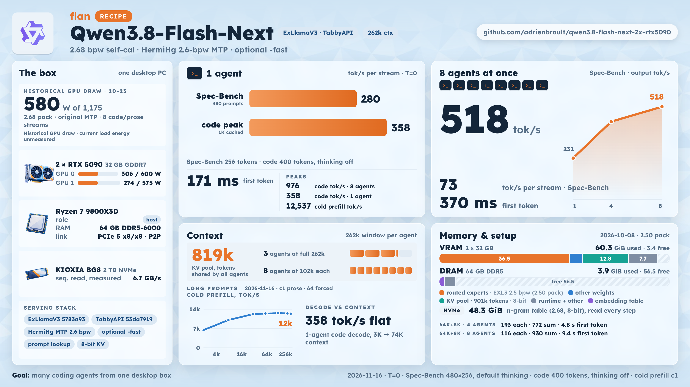
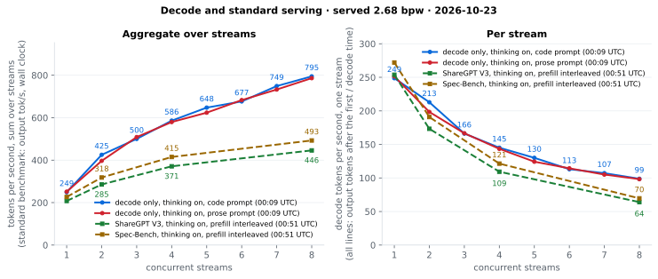
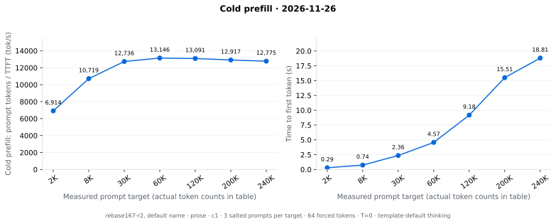
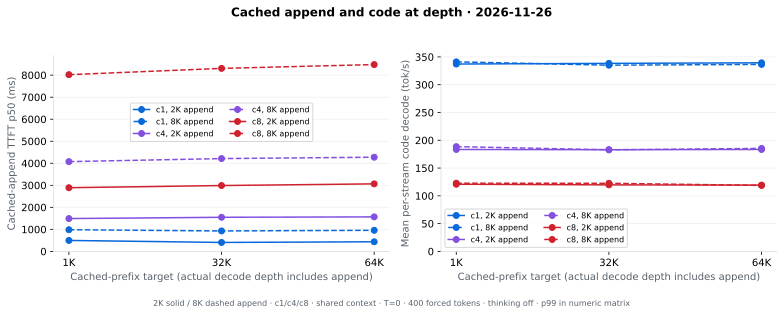

# Qwen3.8-Flash-Next on 2× RTX 5090 (ExLlamaV3 + TabbyAPI)



Serving [Qwen3.8-Flash-Next][qwen-hf] as `qwen3.8-flash-next-exl3-2.68bpw-selfcal` on two RTX 5090 cards through ExLlamaV3 and TabbyAPI. The recipe uses [turboderp’s self-calibrated 2.68 bpw pack][ckpt-268] with the [HermiHg 2.6-bpw MTP head][mtp26], promoted 2026-11-16.

The served image is `tabbyapi:flashnext-names-fast-r1`: pf2lock r3 plus the opt-in name overlay. The [launcher][launcher] sets a 262,144-token request window, an 819,200-token shared page pool, eight slots, 8-bit KV and layer split `[30, 30]`; [history][history] records the promotions.

## Numbers

Measured 2026-11-16 on `tabbyapi:flashnext-names-fast-r1`, the 2.68 bpw pack with the HermiHg MTP graft, pool 819,200 and eight slots: [headline-r1][headline] ([records][headline-data]) and [prefill-r1][prefill] ([records][prefill-data]). The instruments record Spec-Bench at c1/c4/c8, shared cached-code contexts at 1K/32K/64K with 2K/8K appends, and cold prose prompts at 2K–240K; real-work output is completion tokens over benchmark wall, real-work per stream is `1000 / TPOT p50`, and code decode excludes TTFT with aggregate equal to the sum of individually counted common-window rates.



Solid lines are the 120-prompt subset; dashed lines are the full-480 check from the same boot. The panels keep wall output, per-stream decode and first-token latency separate.

- **Parallel agents at depth:** cached code at 32K/64K plus an 8K append, c4/c8, T=0, 400 forced tokens and thinking off; at 64K+c8, TTFT p50 is 9.368 s, mean decode 116.2 tok/s per stream and aggregate 930.0 tok/s. All four cells and the 2K companions are in the [code matrix](#cached-code-matrix).
- **Real work:** Spec-Bench full-480 c8 output is 517.7 tok/s, with 72.8 tok/s per stream and TTFT p50/p99 370.0/925.1 ms; the frozen 120-prompt subset outputs 227.1/433.3/509.1 tok/s at c1/c4/c8. Both use T=0, 256 forced tokens and template-default thinking; [lengths, acceptance and calibration](#standard-benchmark-vllm-bench-serve).
- **Code peaks:** 1K cached plus 2K append, c1, T=0, 400 forced tokens and thinking off, gives 358.4 tok/s per stream; the highest measured aggregate is 975.7 tok/s at 32K cached plus 8K append, c8, under the same sampler and output conditions. The [1K concurrency figure](docs/img/decode-scaling.svg) keeps the 2K/8K append series separate.
- **Cold prefill:** peak 12,537 tok/s at 120,133 prompt tokens, TTFT 9.582 s, c1, prose, T=0 and 64 forced output tokens with template-default thinking. The seven-target curve uses three fresh salted prompts per target ([records][prefill-data]).



Each point is the mean of three cold prose requests at c1; rate is the mean of each request’s prompt tokens / TTFT, including first decode. Actual prompt counts and mean TTFT are in the table; [cached-append TTFT and code decode at depth](docs/img/cached-code.svg) are separate measurements.

| measurement | value | source |
| --- | --- | --- |
| real work · c1 | output 227.1 tok/s; per stream 277.6 tok/s; TTFT p50/p99 173.6/381.6 ms; acceptance 0.6249 | [2026-11-16 subset, 256 forced, T=0][headline] |
| real work · c4 | output 433.3 tok/s; per stream 124.2 tok/s; TTFT p50/p99 268.3/838.3 ms; acceptance 0.6347 | [2026-11-16 subset, 256 forced, T=0][headline] |
| real work · c8 | output 509.1 tok/s; per stream 71.3 tok/s; TTFT p50/p99 373.2/1642.3 ms; acceptance 0.7117 | [2026-11-16 subset, 256 forced, T=0][headline] |
| 1K cached code · c1 | mean per stream 358.4 tok/s; sum 358.4 tok/s | [2026-11-16, 1K cached + 2K append, 400 forced, T=0, thinking off][headline] |
| 1K cached code · c4 | mean per stream 190.0 tok/s; sum 760.2 tok/s | [2026-11-16, 1K cached + 2K append, 400 forced, T=0, thinking off][headline] |
| 1K cached code · c8 | mean per stream 120.9 tok/s; sum 967.1 tok/s | [2026-11-16, 1K cached + 2K append, 400 forced, T=0, thinking off][headline] |
| parallel code · 32K+8K · c4 | mean 191.1 tok/s per stream; sum 764.6 tok/s; TTFT p50 4.662 s | [2026-11-16, 400 forced, T=0, thinking off][headline] |
| parallel code · 32K+8K · c8 | mean 122.0 tok/s per stream; sum 975.7 tok/s; TTFT p50 9.197 s | [2026-11-16, 400 forced, T=0, thinking off][headline] |
| parallel code · 64K+8K · c4 | mean 193.0 tok/s per stream; sum 771.9 tok/s; TTFT p50 4.764 s | [2026-11-16, 400 forced, T=0, thinking off][headline] |
| parallel code · 64K+8K · c8 | mean 116.2 tok/s per stream; sum 930.0 tok/s; TTFT p50 9.368 s | [2026-11-16, 400 forced, T=0, thinking off][headline] |
| cold prefill · 2,012 prompt tokens | 6,381 tok/s; TTFT 0.315 s | [2026-11-16, prose, c1, 64 forced, T=0, template-default thinking][prefill] |
| cold prefill · 7,972 prompt tokens | 10,061 tok/s; TTFT 0.793 s | [2026-11-16, prose, c1, 64 forced, T=0, template-default thinking][prefill] |
| cold prefill · 30,039 prompt tokens | 12,173 tok/s; TTFT 2.468 s | [2026-11-16, prose, c1, 64 forced, T=0, template-default thinking][prefill] |
| cold prefill · 60,079 prompt tokens | 12,406 tok/s; TTFT 4.843 s | [2026-11-16, prose, c1, 64 forced, T=0, template-default thinking][prefill] |
| cold prefill · 120,133 prompt tokens | 12,537 tok/s; TTFT 9.582 s | [2026-11-16, prose, c1, 64 forced, T=0, template-default thinking][prefill] |
| cold prefill · 200,319 prompt tokens | 12,474 tok/s; TTFT 16.059 s | [2026-11-16, prose, c1, 64 forced, T=0, template-default thinking][prefill] |
| cold prefill · 240,329 prompt tokens | 12,357 tok/s; TTFT 19.448 s | [2026-11-16, prose, c1, 64 forced, T=0, template-default thinking][prefill] |
| context / shared pool | 262,144 / 819,200 tokens; eight slots | [launcher][launcher]; [2026-11-16 boot][headline-data] |
| GSM8K five-shot, n=500, no stop strings, c8, T=0, max 8,192 | flexible 0.982; strict 0.976 | [2026-10-23, tune268-r2, original MTP][p268-e] |
| long-context substring retrieval | 5/5 at 105,680 and 5/5 at 193,464 actual prompt tokens, five positions, length finishes | [2026-10-23, tune268-r2, original MTP][p268-e] |
| tool-eval-bench 3.0.0, 69 × 4, c8, T=.6/top_p=.95/top_k=20 | mean 93.8; SD 1.0; 95 % interval 93.0–94.5 | [2026-11-16 before graft, pf2lock r3][te3] |

Also passing: [2026-10-23 tune268-r2 quality outcomes, original MTP][p268-e].

### Conditions

One boot per round, one pass or scored batch per headline cell, and three cold-prefill requests per target after one calibration request. Spec-Bench uses zero cached prompt tokens, a frozen stratified 120-ID subset (seed 7310), greedy 256-token outputs and the template’s thinking default; code uses shared cached context, fresh HumanEval task suffixes, greedy 400-token outputs, thinking off and no logprobs. The [records][headline-data] retain actual prompt lengths, context/task hashes, canonical-token timelines, server counters and the independent tuning-cache seed; cold prefill uses fresh salted prose and 64 forced greedy tokens with template-default thinking, while stock power limits are 600/575 W, core offset zero, memory offset +4500 MHz and NVMe tier off.

## Served configuration

- Image `tabbyapi:flashnext-names-fast-r1`, pinned to `sha256:679274ac51b5ad603347b2364816a118780fc81cda020e20e5291c8a22a7b125`, with 51 launcher selectors including `EXL3_FLASHNEXT_FAST=1` ([image chain][docker-readme]).
- Checkpoint `qwen3.8-flash-next-exl3-2.68bpw-selfcal`: [turboderp 2.68 bpw][ckpt-268], K3 experts on layers 0–3/44–47 and K2.5 on 4–43, dense/shared K6, 6-bit output head, 8-bit n-gram table; duplicate-free [HermiHg 2.6-bpw MTP graft][mtp26] at revision `836df288557a5f2e06ba8de6fefc73851653c981` ([graft utility](scripts/mtphead-graft.py), [pins](scripts/mtphead-pins.json)).
- Window 262,144, pool 819,200, eight slots, 8-bit KV, split `[30, 30]`, draft component on GPU 1 and draft policy `[[4, 3], [8, 2]]`.
- K6 dense V2, K2.5 cooperative decode and grouped E3 prefill selectors enabled; histogram, static and uncapped alternatives at image default 0. Prefill merge, asynchronous recurrent stashes, tail checkpoints, resumable whole-prompt prefill, adaptive lookup and cache trace enabled; NVMe tier off ([configuration][config]).

## What the stack is

[ExLlamaV3][exl3] `dev` `5783a93` (v1.5.2) and [TabbyAPI][tabby] `53da7919` supply the engine and OpenAI-compatible server. The [overlay chain][docker-readme] covers multi-job QSA, batch-indexed MTP, cooperative MoE, dense projections, hyper-connection mixing, two-card prefill, recurrent checkpoints, prompt lookup and the opt-in name policy; [THIRD_PARTY.md][third-party] records origins and licences.

Vision, separate reasoning and `qwen3_coder` tool parsing are enabled. Sampler fallbacks are temperature 1.0, top_k 20 and top_p 0.95 with `force: false`; client settings take precedence ([settings][config]).

## Experimental opt-in `-fast`

Request `qwen3.8-flash-next-exl3-2.68bpw-selfcal-fast` to select FLy-style W=1 rescue on the existing speculative path when entropy is at least 0.3. The default model name retains native acceptance; default-name greedy tokens were identical in the ship check ([screen and ship evidence][headline]).

The 2026-11-16 code/prose screen at c1/c4, 512-token inputs and 128-token caps, with thinking on/off, measured +3 to +36 % at T=1, slower output at T=0.6 and unchanged greedy tokens at T=0. Output is slightly less varied: positional marginal KL was 1.5 % above the standard-vs-standard null and target NLL was lower; this finite-sample screen does not establish task-quality equivalence ([details][headline]).

## Hardware

Read from the box on 2026-09-19. Every number in this README was measured on this hardware and driver; the memory clock offset is stated per period below.

- Host: ASRock X870 Taichi Creator, AMD Ryzen 7 9800X3D, 64 GB DDR5-6000 (2 × 32 GB), Ubuntu 24.04.4 LTS, kernel 7.0.0-30-generic.
- GPUs: two RTX 5090 32 GB (`sm_120`) on PCIe Gen5 x8/x8. Power limits are the cards' defaults, 600 W (ASUS, `cuda:0`) and 575 W (HP OEM, `cuda:1`). Memory clock offset +4500 MHz on both cards, core clock stock. A boot-time service applies them once per host boot, and since 2026-09-25 the launcher sets the memory offset before every engine boot and logs the readback. The offset had reset to 0 between 2026-09-03 and 2026-09-19 without a reboot, so the numbers measured from 2026-09-19 to 2026-09-25 02:22 UTC ran at the stock memory clock; +4500 is +14.3 % DRAM bandwidth and +1.7 to +1.8 % decode per stream at 1 stream ([R726][r726]).
- GPU draw during decode, NVML, run `20261023T000904Z` unit a ([`power-summary.json`](bench/results/20261023T000904Z-publish268-a/power-summary.json)), medians of code and prose rounds: 244 + 237 W at one stream (1.93 J per token), 306 + 274 W at eight streams (0.74 J per token). The cards draw about half their limits; with the layer split each card idles while the other runs its layers.
- Driver: NVIDIA 610.57.04 open kernel modules, CUDA 13.3 user-mode driver.
- Storage: one KIOXIA KBG80ZNV2T04 2 TB NVMe (ext4) holds the checkpoint, including the n-gram table that decode reads rows from; the NVMe prefix tier is disabled by default. A sequential 16 MiB `O_DIRECT` read of a tier segment ran at 6.7 GB/s (2026-09-19).

## Measured and not served

Each entry names the change and the number that kept it out of the served configuration. c1, c4 and c6 mean 1, 4 and 6 concurrent streams.

- A windowed MTP draft cache, a sink page plus the last 16,384 tokens per slot (in the image, off): +3.4 % page pool ([R579][r579]), but a prompt revived from the prompt cache in a later request group drafts 0.655 accepted per proposed token against 0.868 without it, and an agent-shaped replay decodes 2.0 % faster per stream without it ([R728][r728]).
- Mixed draft depth per job inside one verify batch, so 5 to 7 streams fill the 16 verify rows: 0.79× at 5 streams and 0.84× at 7, code, 256 forced tokens, greedy. The verify window grows to the deepest job in the batch, which adds a sequential draft level to every step ([R678b][r678b]).
- 17 to 32 verify rows on the cooperative MoE kernels, as two calls of at most 16 rows: bit-identical, −14.5 % at 8 streams against drafting one token ([R566][r566]). One launch of up to 32 rows is served since 2026-09-25 ([R717][r717]).
- Draft depth 2 above 4 jobs on the 16-row decode paths: −32 to −39 % at 6 and 8 streams, because 18 and 24 verify rows fell off the cooperative MoE decode kernels (2026-09-19, [R560][r560], [R562][r562]). With the rows32 paths depth 2 at 6 to 8 jobs is served since 2026-09-25 ([R717][r717]).
- Draft depth 4 at 1 stream, with or without a controller: costs 32,768 page-pool tokens and returns at most about +2 % ([R567][r567]).
- A deeper MTP draft for a single decoding job (depth 4 or 5 instead of 3), all arms at a 753,664-token pool: +4.8 / +5.2 % code and −5.4 / −8.2 % prose at 1 stream against depth 3, 16,384 / 49,152 fewer pool tokens than the served 819,200 of that date, and a different greedy output (2026-09-19, [R537][r537]).
- Adaptive MTP draft depth, round 2: −2.4 to −3.5 % prose at 1 stream, no gain on code ([R556][r556]).
- Two draft chains verified together: +5 to +6.5 % accepted tokens for twice the verify rows, modelled at −10 to −13 % ([R564][r564]).
- A 4,096-token prefill chunk: does not boot beside the page pool ([R574][r574]).
- Prefill chunk 1,024 or 512 instead of 2,048: running streams get 1.5× the decode frames while another request prefills, but cold prefill runs at about half the rate and the new request waits 1.4–1.7× longer for its first token ([R553][r553]). Chunk 1,024 for pool size: [R483][r483], [R485][r485].
- The served stack on upstream `dev` `1d64111`: −49,152 pool tokens and 1–3 % decode ([R563][r563]). A later port onto `dev` `5783a93` is served since 2026-09-27, at −81,920 pool tokens ([R784][r784]).
- The MTP draft's embedding copy on cuda:0: +16,384 pool tokens for −1.8 % code and −2.0 % prose at 1 stream ([R555][r555]).
- The K=3 MoE decode kernel without register spills: bit-exact, slower per call in 28 of 30 kernel cells, −0.37 % code at c1 over 8 boots with a 95 % interval of −0.83 to +0.09 % (2026-09-19, [R536][r536]).
- Recurrent checkpoints stored at the end of each reply: correct, but they save about 9k prefill tokens over a 120-call agent replay, below its run-to-run spread ([R524][r524]).
- A fused shared-expert kernel: after the side-stream overlap the shared expert's residual is 1.9 µs per layer at 4 rows, at most 0.6 % of a 1-stream step and 1.2 % at 4 streams ([R521][r521]).
- `EXL3_INT8_GEMV=0`: −0.3 % at c1 with a 95 % interval of ±1.2 % over 8 boots ([R520b][r520b]).
- 6 decode slots: +17 % at c6 and 9 % slower on an 8-agent replay, measured before the bf16 GDN state halved the per-slot cost ([R518][r518]).
- Split [30, 31] at 393,216 ([R487][r487]).
- The n-gram table in host RAM, on the 3.05 bpw pack: +1–2 % for 30.5 GiB, measured before the served row prefetch ([R484][r484]). The served 2.68 pack's table is 48.3 GiB on a 60 GiB host.
- The host KV tier ([R358][r358], [R493][r493]); GDN state replay ([R496][r496]); a 4-bit MTP graft ([R498][r498]); CPU-offloaded experts ([R482][r482]); MoE coop mode 3 ([R462][r462]).
- The 2026-09-18 prompt-lookup variant: +3–4 % on code at c1, flat at c4 ([R501][r501]).
- K8V4: +18 % pool for −11 % code at c1 ([R480][r480]).
- [exllamav3#303][pr303] MTP hot vocabulary ([R377][r377]); [exllamav3#246][pr246] and [#290][pr290] ([R365][r365]); a 32-row MoE decode envelope written for this stack ([R366][r366]).
- The same checkpoint on vLLM through [vllm-exl3][vllm-exl3]: 0.62× the c1 and 1.06–1.12× the c4 of this stack's 3.05 bpw configuration of 2026-09-18. Work on that route stopped the same day ([vLLM route][vllm-route]).

## How the numbers are measured

The [headline-r1 write-up][headline] records the completed source snapshot, source hashes and validation receipt. [`bench/sanitize_headline.py`](bench/sanitize_headline.py) exports numeric observations, IDs and hashes; [`bench/headline.py`](bench/headline.py) independently recomputes the rates, quantiles, acceptance, τ and common-window counts. [`bench/plot.py`](bench/plot.py) reads the public headline and [cold-prefill exports][prefill-data] and fails on missing files or cells; run `uv run bench/plot.py` to regenerate the four current figures. [`bench/prefill.py`](bench/prefill.py) recomputes the seven cold-prefill cells from all 22 request records; [`bench/sanitize_prefill.py`](bench/sanitize_prefill.py) exports an explicit field allowlist and verifies the source packet hashes.

### Cached code matrix



Measured 2026-11-16, `tabbyapi:flashnext-names-fast-r1`, default model with HermiHg MTP, T=0, thinking off, no logprobs, 400 forced tokens per request. Every row reuses the shared slot-0 prefix across c1/c4/c8 and both append sizes, with fresh HumanEval suffixes selected by the frozen warmup/scored task selector (offsets 0/1/5); tokenizer calibration determines actual lengths. Per-stream is the arithmetic mean of individually counted canonical-token rates inside `(last first-text frame, first last-text frame]`; aggregate is their sum. The [numeric records][headline-data] retain each stream’s prompt/cached lengths, task ID/hash, context hash, duration and counted tokens; totals match server usage, which does not prove per-frame generator segmentation.

| cached prefix | append | streams | TTFT p50 / p99 ms | decode sum tok/s | mean per stream tok/s | new tokens / summed TTFT, tok/s | accepted / proposed (fraction) | τ |
| ---: | ---: | ---: | ---: | ---: | ---: | ---: | ---: | ---: |
| 1,024 | 2,048 | 1 | 530.6 / 530.6 | 358.4 | 358.4 | 3982.1 | 294/318 (0.9245) | 3.77 |
| 1,024 | 2,048 | 4 | 1703.0 / 1703.4 | 760.2 | 190.0 | 1240.5 | 1153/1341 (0.8598) | 3.58 |
| 1,024 | 2,048 | 8 | 3313.3 / 3313.8 | 967.1 | 120.9 | 637.6 | 2058/2302 (0.8940) | 2.80 |
| 1,024 | 8,192 | 1 | 1061.9 / 1061.9 | 360.8 | 360.8 | 7776.0 | 294/318 (0.9245) | 3.77 |
| 1,024 | 8,192 | 4 | 4513.4 / 4513.7 | 777.6 | 194.4 | 1831.1 | 1145/1365 (0.8388) | 3.52 |
| 1,024 | 8,192 | 8 | 8929.8 / 8930.4 | 971.0 | 121.4 | 924.8 | 2054/2309 (0.8896) | 2.79 |
| 32,768 | 2,048 | 1 | 498.5 / 498.5 | 355.3 | 355.3 | 4240.5 | 293/321 (0.9128) | 3.74 |
| 32,768 | 2,048 | 4 | 1748.2 / 1748.5 | 764.7 | 191.2 | 1209.1 | 1155/1335 (0.8652) | 3.60 |
| 32,768 | 2,048 | 8 | 3377.6 / 3378.0 | 965.4 | 120.7 | 625.9 | 2058/2300 (0.8948) | 2.80 |
| 32,768 | 8,192 | 1 | 1053.9 / 1053.9 | 357.2 | 357.2 | 7835.7 | 294/318 (0.9245) | 3.77 |
| 32,768 | 8,192 | 4 | 4662.0 / 4662.3 | 764.6 | 191.1 | 1772.9 | 1146/1362 (0.8414) | 3.52 |
| 32,768 | 8,192 | 8 | 9197.4 / 9198.0 | 975.7 | 122.0 | 898.1 | 2061/2296 (0.8976) | 2.81 |
| 65,536 | 2,048 | 1 | 574.8 / 574.8 | 358.3 | 358.3 | 3677.5 | 295/315 (0.9365) | 3.81 |
| 65,536 | 2,048 | 4 | 1788.4 / 1788.8 | 765.6 | 191.4 | 1181.9 | 1153/1341 (0.8598) | 3.58 |
| 65,536 | 2,048 | 8 | 3466.8 / 3467.4 | 944.6 | 118.1 | 609.7 | 2045/2326 (0.8792) | 2.77 |
| 65,536 | 8,192 | 1 | 1138.9 / 1138.9 | 357.6 | 357.6 | 7251.1 | 295/315 (0.9365) | 3.81 |
| 65,536 | 8,192 | 4 | 4763.7 / 4764.1 | 771.9 | 193.0 | 1735.0 | 1161/1317 (0.8815) | 3.64 |
| 65,536 | 8,192 | 8 | 9367.8 / 9368.4 | 930.0 | 116.2 | 881.8 | 2040/2334 (0.8740) | 2.76 |

New prompt tokens / summed TTFT includes HTTP, scheduling and first decode, with contention at c4/c8; it is not isolated cold prefill. Accepted/proposed and τ counters cover the whole scored batch, rather than the smaller decode window. All warm/confirm phases are excluded.

### Historical measurements before the MTP graft

The following measurements keep their original date and configuration and do not describe the current speed headlines. Quality results carry forward for the default model because the MTP swap and name overlay passed greedy token identity; the experimental alias changes sampled output and inherits no quality-equivalence claim.

The corrected 2026-11-16 probe of the old curve’s exact code/prose request 0 records all 1,024 completion tokens in reasoning and zero answer characters: code 390 reasoning frames / 4,929 characters, prose 385 / 4,492. The earlier thinking/answer frame splits were incorrect and are withdrawn; frame or character shares are not token shares ([corrected numeric observations][headline-data], [dated write-up][dk-md]).

The [2026-10-23 publication write-up][p268] names all inputs and definitions. Decode, prefill and depth come from `20261023T000904Z`, units a/b/c, on `tabbyapi:tune268-r2`, before the MTP graft. `fn_bench` ([`bench/probe.py`][probe]) records one line per request, forces length through `min_tokens`, checks `finish_reason=length` and retains both server completion counts and streamed frame counts.

Decode uses two boots, one unrecorded warm-up plus three recorded rounds per shape, greedy 1,024-token outputs, one to eight distinct streams, code prompts of 118 tokens and prose prompts of 106. Per-stream is the median request rate `(completion_tokens - 1) / decode_window_s`; aggregate is the mean round sum of concurrent request rates. The secondary round-wall aggregate includes TTFT and straggler tails. Every stream decodes together during 91.3–98.4% of the mean decode window at two to eight streams. The maximum two-boot spread is 2.56% for per-stream medians and 1.98% for decode aggregate ([records][p268-a]).

| streams | decode per stream, t/s, code / prose | decode aggregate, t/s, code / prose | TTFT, s, code / prose | round-wall aggregate, t/s, code / prose |
| ---: | ---: | ---: | ---: | ---: |
| 1 | 248.7 / 251.4 | 249 / 251 | 0.163 / 0.155 | 239.7 / 242.4 |
| 2 | 212.9 / 198.4 | 425 / 397 | 0.293 / 0.281 | 394.9 / 367.8 |
| 3 | 166.2 / 166.6 | 500 / 509 | 0.429 / 0.410 | 459.6 / 451.3 |
| 4 | 145.1 / 143.4 | 586 / 580 | 0.561 / 0.540 | 528.6 / 528.7 |
| 5 | 130.0 / 124.2 | 648 / 624 | 0.696 / 0.667 | 585.9 / 566.2 |
| 6 | 113.0 / 114.4 | 677 / 683 | 0.847 / 0.777 | 609.9 / 621.6 |
| 7 | 107.2 / 105.1 | 749 / 733 | 0.844 / 0.808 | 673.8 / 668.7 |
| 8 | 98.8 / 98.2 | 795 / 786 | 0.919 / 0.910 | 712.6 / 709.0 |

Historical cold prefill used three salted prompts at each of five targets, excluded calibration from the chart and measured `prompt_tokens / ttft_s`, with 64 forced greedy output tokens. Historical depth used code filler budgets 0/74,000/148,000 and prose budgets 0/133,000/266,000; each shape had a cold/cached pair at one stream with 2,048 forced greedy output tokens. That chart used actual prompt counts and mean decode t/s; tokens/frame is `completion_tokens/client_frames`, and ms/frame is `1000*decode_window_s/client_frames` ([prefill][p268-b], [depth][p268-c]).

| kind | actual prompt tokens | decode t/s | tokens per frame | ms per frame |
| --- | ---: | ---: | ---: | ---: |
| code | 101 | 295.715 | 3.14110 | 10.61887 |
| code | 100,435 | 290.535 | 3.16049 | 10.87423 |
| code | 199,822 | 252.815 | 2.82975 | 11.18570 |
| prose | 89 | 244.275 | 2.57935 | 10.55542 |
| prose | 99,878 | 268.530 | 2.93414 | 10.91797 |
| prose | 199,915 | 379.975 | 3.94605 | 10.38054 |

Current figures are drawn by [`bench/plot.py`](bench/plot.py) from headline-r1 only; these earlier measurements do not enter them.

**Decode by content, thinking off** ([write-up][dk-md], [records][dk-run]): `vllm bench serve` sends Spec-Bench's 480 prompts and 80 MBPP prompts (test split, task 11 to 90) with `chat_template_kwargs.enable_thinking=false`, temperature 0 and a 1,024-token cap without `min_tokens`, at one and at four streams, on two fresh boots. Each request is checked for zero thinking frames. The rate is step-based: tokens per decode step from the server's per-request counters, divided by the mean interval between streamed frames, the pass mean. The client formula `(output_tokens - 1) / (latency - TTFT)` overstates answers of a few decode steps, because the last step's tokens arrive in two frames 0.1 ms apart: by 43 % on 26-token translations and 10–15 % on MBPP and extraction answers, by 0–3 % above 150 tokens. MBPP stands in for a code-generation set. The MT-Bench categories have 10 prompts each and the others 80. MiaAI-Lab's `bench_decode.py` prompts are reported with their step counts in the write-up.

The [dated content figure](docs/img/decode-by-content.svg) retains the pre-graft 2026-11-16 measurements.

## Standard benchmark (`vllm bench serve`)

The primary rows below are the 2026-11-16 Spec-Bench frozen 120-prompt subset on the served 2.68/HermiHg model and `tabbyapi:flashnext-names-fast-r1`, default name, pool 819,200, c1/c4/c8 in one boot. The TabbyAPI-adapted benchmark submits all arrivals at once, limits active requests to c, uses template-default thinking, T=0 and `min_tokens=max_tokens=256`; server evidence records zero cached prompt tokens. [Per-request numeric observations and input hashes][headline-data] preserve all six cells.

| size · streams | output tok/s (wall) | req/s | per-stream tok/s (1000 / TPOT p50) | TTFT p50 / p99 ms | TPOT p50 / p99 ms | E2E p50 s | accepted / proposed (fraction) | τ |
| --- | ---: | ---: | ---: | ---: | ---: | ---: | ---: | ---: |
| subset · 1 | 227.1 | 0.887 | 277.6 | 173.6 / 381.6 | 3.60 / 4.49 | 1.11 | 20034/32058 (0.6249) | 2.87 |
| subset · 4 | 433.3 | 1.693 | 124.2 | 268.3 / 838.3 | 8.05 / 10.47 | 2.35 | 20142/31734 (0.6347) | 2.90 |
| subset · 8 | 509.1 | 1.989 | 71.3 | 373.2 / 1642.3 | 14.03 / 17.11 | 3.97 | 18082/25406 (0.7117) | 2.43 |

Output tok/s is all completion tokens / benchmark wall; per stream is `1000 / TPOT p50`, with TPOT `(E2E − TTFT)/(output_tokens − 1)`. Acceptance is accepted / proposed drafts; τ is `generated/(generated − accepted)`, including the prefill token, and is not accepted drafts per step.

### Full-480 check

The full set uses the same configuration and output length, with its own leading cell/question labels and order seeds to prevent prefix reuse.

| size · streams | output tok/s (wall) | req/s | per-stream tok/s (1000 / TPOT p50) | TTFT p50 / p99 ms | TPOT p50 / p99 ms | E2E p50 s | accepted / proposed (fraction) | τ |
| --- | ---: | ---: | ---: | ---: | ---: | ---: | ---: | ---: |
| full · 1 | 231.1 | 0.903 | 279.9 | 171.3 / 366.6 | 3.57 / 4.62 | 1.10 | 80624/126768 (0.6360) | 2.91 |
| full · 4 | 434.6 | 1.698 | 126.0 | 272.5 / 759.5 | 7.93 / 10.16 | 2.33 | 80625/126765 (0.6360) | 2.91 |
| full · 8 | 517.7 | 2.022 | 72.8 | 370.0 / 925.1 | 13.74 / 17.12 | 3.91 | 72870/100224 (0.7271) | 2.46 |

### Subset/full calibration

Each value is subset / full for the named summary field, without pooling the two sets or dropping tail cells. Spec-Bench reports TTFT p50/p99 separately from the cold-prefill curve.

| streams | output | per stream | TTFT p50 | TTFT p99 | acceptance | τ |
| ---: | ---: | ---: | ---: | ---: | ---: | ---: |
| 1 | 0.9825 | 0.9918 | 1.0137 | 1.0409 | 0.9826 | 0.9886 |
| 4 | 0.9970 | 0.9853 | 0.9846 | 1.1037 | 0.9979 | 0.9987 |
| 8 | 0.9834 | 0.9794 | 1.0089 | 1.7753 | 0.9789 | 0.9893 |

Earlier ShareGPT, Spec-Bench c2, content-category speed, cold-prefill and 100K/200K depth measurements remain dated in the [2026-10-23 write-up][p268] and [2026-11-16 pre-graft content write-up][dk-md]. They do not enter the current headline charts.

## Reproducing a boot

```sh
bash docker/build-chain.sh              # builds through tabbyapi:flashnext-names-fast-r1
# Review and update R825C_IMAGE_ID in the launcher for the rebuilt image before serving.
# Download the pinned MTP sidecar and preserve the original checkpoint as <served>-base.
# With the server stopped, build a new served directory from that preserved base:
python3 scripts/mtphead-graft.py build "$BASE_CHECKPOINT" "$MTP_SIDECAR" "$SERVED_CHECKPOINT" scripts/mtphead-pins.json
python3 scripts/mtphead-graft.py verify "$BASE_CHECKPOINT" "$MTP_SIDECAR" "$SERVED_CHECKPOINT" scripts/mtphead-pins.json
ssh flan 'bash -s' < scripts/launch-flashnext.sh
STOP=1 bash scripts/launch-flashnext.sh
```

Rebuilding the image chain, running the measurements and handing the box back are in [`docs/RUNBOOK.md`][runbook].

## Repository map

| path | what it is |
| --- | --- |
| [`scripts/launch-flashnext.sh`][launcher] | the served launcher: writes the config and the sampler preset, starts the container, warms the kernels |
| [`scripts/launchers/`][launchers] | the launcher of each promotion and experiment, for rollback and reproduction |
| [`scripts/r*.sh`][scripts] | one driver per experiment, each under the box's GPU lock |
| [`docker/`][docker-readme] | the served image layer by layer: Dockerfiles, patches, overlays with SHA-pinned installers and kernel tests |
| [`bench/RESULTS.md`][results] | index of every experiment, newest first; one file per experiment in [`bench/results/`][bench-results] with its raw records |
| [`bench/probe.py`][probe] | decode, concurrency and depth instrument (`fn_bench`): forced length via `min_tokens`, one JSONL line per request |
| [`bench/multiprompt.py`][multiprompt], [`bench/agentic-edit.py`][agentic-edit] | sampled multi-prompt decode, and agent-shaped file edits |
| [`bench/needle.py`][needle], [`bench/capabilities.py`][capabilities] | long-context retrieval at five planted positions; JSON schema, tool parsing, vision and reasoning checks |
| [`bench/nostop_proxy.py`][nostop] | drops the request's `stop` field so lm-eval's stop strings cannot cut reasoning |
| [`bench/agent_replay.py`][agent-replay], [`bench/revisit.py`][revisit] | recorded agent conversations replayed at concurrency; revisits of evicted long sessions |
| [`bench/vllm_bench_tabby.py`][vllm-bench-tabby], [`bench/std_bench_summary.py`][std-bench-summary] | `vllm bench serve` v0.30.0 adapted to TabbyAPI (usage frame, CRLF events, `min_tokens`, Spec-Bench templated once); the tables and checks of a standard-benchmark run |
| [`docs/CONFIG.md`][config] | every setting and flag, and why it has that value |
| [`docs/HISTORY.md`][history] | how the served configuration changed, with the result behind each step |
| [`docs/PROMOTION.md`][promotion] | the gates a candidate passes before it is served |
| [`docs/GOTCHAS.md`][gotchas] | the traps, as "what it looks like" against "what it is" |
| [`docs/RUNBOOK.md`][runbook] | serve, measure, rebuild and hand the box back |
| [`THIRD_PARTY.md`][third-party] | where every input came from and under which licence |
| [`CLAUDE.md`][claude-md] | the working agreement: prose rules, box rules, measurement rules |

## Attribution and licence

The original work here (documentation, instruments, launcher, overlay installers, measurements) is [MIT][license]. The model is the Qwen team's under the Qwen Community License; the served checkpoint is [turboderp's self-calibrated 2.68 bpw quant][ckpt-268], with [r0b0tlab's][ckpt-250] and other [turboderp packs][ckpt-turbo] retained in historical measurements; the engine is [ExLlamaV3][exl3] (MIT) and the server [TabbyAPI][tabby] (AGPL-3.0), and every kernel patch in [`docker/`][docker-readme] is a derivative of one of them. The patches were written with coding agents from static source dumps and admitted or rejected by measurement on the box. Ideas were taken from [vcruz305's DGX Spark recipe][vcruz-recipe], [DominikBucko][bucko], [HaberstrohSystems][haberstroh] and [halogen][halogen]; the full table is in [`THIRD_PARTY.md`][third-party].

## Links

Model and checkpoints: [Qwen3.8-Flash-Next][qwen-hf] · [r0b0tlab 2.50 bpw][ckpt-250] · [turboderp EXL3 packs][ckpt-turbo]

Engine and server: [ExLlamaV3][exl3] · [EXL3 conversion][exl3-convert] · [TabbyAPI][tabby] · [llguidance][llguidance]

Upstream pull requests measured here: [exllamav3#246][pr246] · [#284][pr284] · [#290][pr290] · [#299][pr299] · [#303][pr303] · [#337][pr337]

Other setups of this model: [vcruz305 DGX Spark recipe][vcruz-recipe] · [vcruz305/vllm-exl3][vllm-exl3] · [DominikBucko, 2× RTX 3090][bucko] · [HaberstrohSystems, 24 GB SGLang][haberstroh]

Benchmarks and harnesses: [tool-eval-bench][tool-eval] · [mini-SWE-agent][mini-swe] · [SWE-bench][swebench] · [lm-evaluation-harness][lm-eval] · [halogen][halogen] · [vLLM][vllm] (`vllm bench serve`) · [ShareGPT V3][sharegpt] · [Spec-Bench][spec-bench]

[qwen-hf]: https://huggingface.co/Qwen/Qwen3.8-Flash-Next
[ckpt-250]: https://huggingface.co/r0b0tlab/Qwen3.8-Flash-Next-EXL3-2.50bpw
[ckpt-turbo]: https://huggingface.co/turboderp/Qwen3.8-Flash-Next-exl3
[exl3]: https://github.com/turboderp-org/exllamav3
[exl3-825db5b]: https://github.com/turboderp-org/exllamav3/commit/825db5b
[exl3-convert]: https://github.com/turboderp-org/exllamav3/blob/master/doc/convert.md
[tabby]: https://github.com/theroyallab/tabbyAPI
[llguidance]: https://github.com/guidance-ai/llguidance
[vllm-exl3]: https://github.com/vcruz305/vllm-exl3
[vcruz-recipe]: https://github.com/vcruz305/Qwen3.8-Flash-Next-EXL3-DGX-Spark-recipe
[bucko]: https://github.com/DominikBucko/qwen38-flash-next-2x3090
[haberstroh]: https://github.com/HaberstrohSystems/qwen3.8-flash-next-24gb-sglang
[halogen]: https://github.com/peonist-ai/halogen
[tool-eval]: https://github.com/SeraphimSerapis/tool-eval-bench
[mini-swe]: https://github.com/SWE-agent/mini-swe-agent
[swebench]: https://github.com/SWE-bench/SWE-bench
[lm-eval]: https://github.com/EleutherAI/lm-evaluation-harness
[vllm]: https://github.com/vllm-project/vllm
[sharegpt]: https://huggingface.co/datasets/anon8231489123/ShareGPT_Vicuna_unfiltered
[spec-bench]: https://github.com/hemingkx/Spec-Bench
[pr246]: https://github.com/turboderp-org/exllamav3/pull/246
[pr284]: https://github.com/turboderp-org/exllamav3/pull/284
[pr290]: https://github.com/turboderp-org/exllamav3/pull/290
[pr299]: https://github.com/turboderp-org/exllamav3/pull/299
[pr303]: https://github.com/turboderp-org/exllamav3/pull/303
[pr337]: https://github.com/turboderp-org/exllamav3/pull/337

[launcher]: scripts/launch-flashnext.sh
[launchers]: scripts/launchers/
[scripts]: scripts/
[r521-driver]: scripts/r521-shared-bound.sh
[r522-driver]: scripts/r522-mtp-pruned.sh
[r523-driver]: scripts/r523-tool-choice.sh
[r524-driver]: scripts/r524-recurrent-tip.sh
[docker-readme]: docker/README.md
[results]: bench/RESULTS.md
[bench-results]: bench/results/
[probe]: bench/probe.py
[multiprompt]: bench/multiprompt.py
[agentic-edit]: bench/agentic-edit.py
[needle]: bench/needle.py
[capabilities]: bench/capabilities.py
[nostop]: bench/nostop_proxy.py
[agent-replay]: bench/agent_replay.py
[revisit]: bench/revisit.py
[vllm-bench-tabby]: bench/vllm_bench_tabby.py
[std-bench-summary]: bench/std_bench_summary.py
[config]: docs/CONFIG.md
[config-memory]: docs/CONFIG.md#memory
[history]: docs/HISTORY.md
[promotion]: docs/PROMOTION.md
[gotchas]: docs/GOTCHAS.md
[runbook]: docs/RUNBOOK.md
[third-party]: THIRD_PARTY.md
[claude-md]: CLAUDE.md
[license]: LICENSE

[agent-cost]: bench/results/swebench-agent-cost.md
[duty]: bench/results/gpu-duty-cycle.md
[vllm-route]: bench/results/vllm-exl3-route.md
[r340]: bench/results/r340-ci-depth.md
[r341]: bench/results/r341-qsa.md
[r358]: bench/results/r358-hostkv.md
[r359]: bench/results/r359-swebench.md
[r362]: bench/results/r362-pr337.md
[r365]: bench/results/r365-kernels.md
[r366]: bench/results/r366-ourkernel.md
[r377]: bench/results/r377-hotvocab-on.md
[r414]: bench/results/r414-bszn16.md
[r421]: bench/results/r421-coopwide-ab.md
[r428]: bench/results/r428-hcmix2-stack-ab.md
[r442]: bench/results/r442-ppipe.md
[r453]: bench/results/r453-exl3-structured.md
[r460]: bench/results/r460-moecoop-v2-ab.md
[r462]: bench/results/r462-moecoop-v3-ab.md
[r480]: bench/results/r480-exl3-pool.md
[r482]: bench/results/r482-cold-experts.md
[r483]: bench/results/r483-exl3-pool-chunk.md
[r484]: bench/results/r484-ngram-ram.md
[r485]: bench/results/r485-pool-frontier.md
[r487]: bench/results/r487-pool-393k.md
[r490]: bench/results/r490-shared-overlap.md
[r492]: bench/results/r492-depth.md
[r493]: bench/results/r493-host-kv-tier.md
[r495b]: bench/results/r495b-2p50-audition.md
[r496]: bench/results/r496-gdn-state-r3.md
[r497]: bench/results/r497-draft-confidence.md
[r498]: bench/results/r498-mtp4-graft.md
[r499]: bench/results/r499-decode-r4.md
[r501]: bench/results/r501-prompt-lookup.md
[r509]: bench/results/r509-gsm8k-nostop.md
[r511]: bench/results/r511-promote-2p50.md
[r513]: bench/results/r513-prefill-e3-r2.md
[r516]: bench/results/r516-int8-mixer-pool.md
[r517]: bench/results/r517-promote-stack.md
[r525]: bench/results/r525-promote-int8mix.md
[r528]: bench/results/r528-promote-mtp-pruned.md
[r529]: bench/results/r529-promote-tool-choice.md
[r527]: bench/results/r527-tp-bound.md
[r530]: bench/results/r530-promote-plefix.md
[r524]: bench/results/r524-recurrent-tip.md
[r526]: bench/results/r526-nvme-tier.md
[r532]: bench/results/r532-nvme-tier-r4.md
[r533]: bench/results/r533-e3-det-precise.md
[r534]: bench/results/r534-promote-nvme-tier.md
[r535]: bench/results/r535-promote-e3det.md
[r536]: bench/results/r536-nospill.md
[r537]: bench/results/r537-draft-depth.md
[r538]: bench/results/r538-decode-r6.md
[r540]: bench/results/r540-promote-r6.md
[r546]: bench/results/r546-promote-rawk.md
[r548]: bench/results/r548-promote-gdnbf16-ring.md
[r549]: bench/results/r549-hot-slots.md
[r552b]: bench/results/r552b-c4-stream-count.md
[r553]: bench/results/r553-chunk-hot-stall.md
[r554]: bench/results/r554-depth-decode.md
[r555]: bench/results/r555-headdev-mirror.md
[r556]: bench/results/r556-adaptive-draft-r2.md
[r557]: bench/results/r557-agent-replay-daily.md
[r558]: bench/results/r558-slots8.md
[r560]: bench/results/r560-c8-policy.md
[r561]: bench/results/r561-promote-slots8.md
[r562]: bench/results/r562-profile-c8.md
[r559]: bench/results/r559-ngram-prefetch.md
[r565]: bench/results/r565-promote-ngram-prefetch.md
[r563]: bench/results/r563-rebase-dev.md
[r564]: bench/results/r564-draft-topk.md
[r566]: bench/results/r566-moe-rows32.md
[r567]: bench/results/r567-adaptive-draft-r3.md
[r568]: bench/results/r568-rebase-prefill.md
[r569]: bench/results/r569-mtp-kv-window.md
[r570]: bench/results/r570-c5-draft-policy.md
[r571]: bench/results/r570-c5-draft-policy.md
[r572]: bench/results/r572-mtp-acceptance.md
[r573]: bench/results/r573-mtp-kv-window-screen.md
[r574]: bench/results/r574-chunk4096.md
[r575]: bench/results/r575-promote-mtp-kv-window.md
[r579]: bench/results/r579-promote-mtp-kv-window.md
[r580]: bench/results/r580-decode-curve.md
[r704]: bench/results/r704-decode-curve.md
[r719]: bench/results/r719-decode-curve.md
[r719b]: bench/results/r719b-decode-curve.md
[r731b]: bench/results/r731b-std-bench.md
[r726]: bench/results/r726-memoc.md
[r728]: bench/results/r728-promote-window-off.md
[r783]: bench/results/r783-loopthink.md
[r587]: bench/results/r587-tabby-metrics.md
[r583]: bench/results/r583-long-generation.md
[r585]: bench/results/r585-prefill-interference.md
[r784]: bench/results/r784-rebase-dev-r3.md
[r786]: bench/results/r786-replay-abba.md
[r787]: bench/results/r787-bench-refresh.md
[r811]: bench/results/r811-r813-std-bench-merge.md
[r792]: bench/results/r792-promote-loopthink5.md
[r808]: bench/results/r805-r808-tokenize-offloop.md
[r809]: bench/results/r803-r810-prefill-merge.md
[r581]: bench/results/r581-split-rebalance.md
[hot-slots]: bench/hot_slots.py
[r521]: bench/results/r521-shared-bound.md
[r522]: bench/results/r522-mtp-pruned.md
[r528-driver]: scripts/r528-promote-mtp-pruned.sh
[r522b-driver]: scripts/r522b-mtp-pruned-precise.sh
[r526-driver]: scripts/r526-nvme-tier.sh
[r518]: bench/results/r518-slots6.md
[r519]: bench/results/r519-profile-2p50.md
[r520]: bench/results/r520-int8gemv.md
[r520b]: bench/results/r520b-int8gemv-precise.md
[r646]: bench/results/r646-verifybatch.md
[r653]: bench/results/r653-stack.md
[r676]: bench/results/r676-slotfix.md
[r694]: bench/results/r694-mtp-card1.md
[r678b]: bench/results/r678b-fill16.md
[r698]: bench/results/r698-hcfast.md
[r700b]: bench/results/r700b-moefast.md
[r701]: bench/results/r701-stack-r2.md
[r702]: bench/results/r702-hcfast-r2.md
[r712]: bench/results/r712-latchain-r1.md
[r713]: bench/results/r713-moefast-r3.md
[r714]: bench/results/r714-densegemm-r2.md
[r716b]: bench/results/r716b-stack-r3.md
[r717]: bench/results/r717-rows32.md
[r586]: bench/results/r586-swebench-500.md
[r815]: bench/results/r815-r820-fast-state.md
[r823]: bench/results/r823-tail-checkpoints.md

[r826]: bench/results/r826-std-ab.md

[r828]: bench/results/r827-r828-prompt-lookup.md

[p268]: bench/results/publish268-served-268.md
[dk-run]: bench/results/20261116T102550Z-decodekinds-r1/
[dk-md]: bench/results/decodekinds-r1.md
[dk-split]: bench/results/20261116T102550Z-decodekinds-r1/thinking-split.jsonl
[te3]: bench/results/tooleval-bench-3.md
[p268-a]: bench/results/20261023T000904Z-publish268-a/
[p268-b]: bench/results/20261023T000904Z-publish268-b/
[p268-c]: bench/results/20261023T000904Z-publish268-c/
[p268-d]: bench/results/20261023T005148Z-publish268-d/
[p268-e]: bench/results/20261023T031345Z-publish268-e/
[ckpt-268]: https://huggingface.co/turboderp/Qwen3.8-Flash-Next-exl3/tree/2.68bpw_h6_ng8

[headline]: bench/results/headline-r1.md
[headline-data]: bench/results/2026-11-16-headline-r1/
[mtp26]: https://huggingface.co/HermiHg/Qwen3.8-Flash-Next-Optimized-MTP-Heads-exl3/tree/836df288557a5f2e06ba8de6fefc73851653c981
[prefill]: bench/results/prefill-r1.md
[prefill-data]: bench/results/2026-11-16-prefill-r1/
